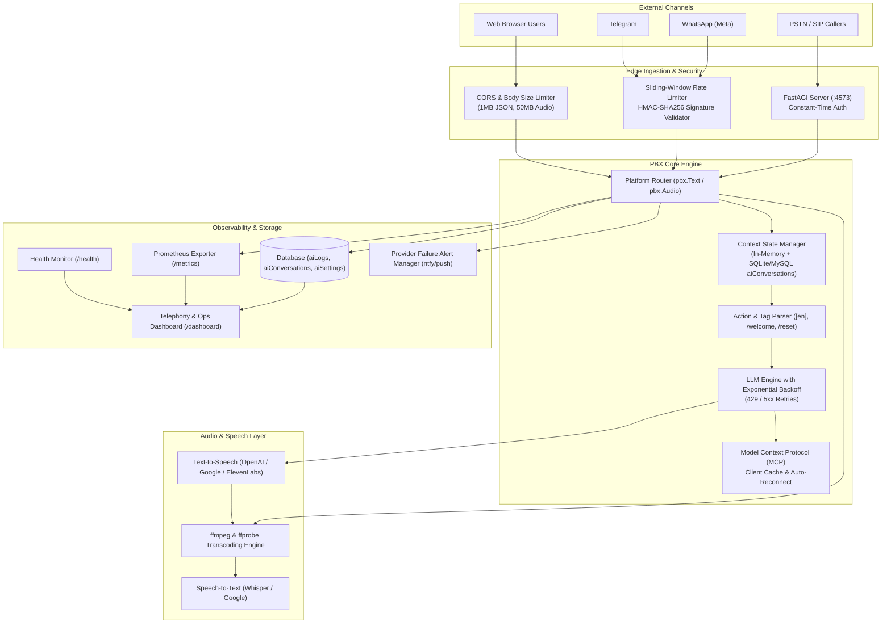
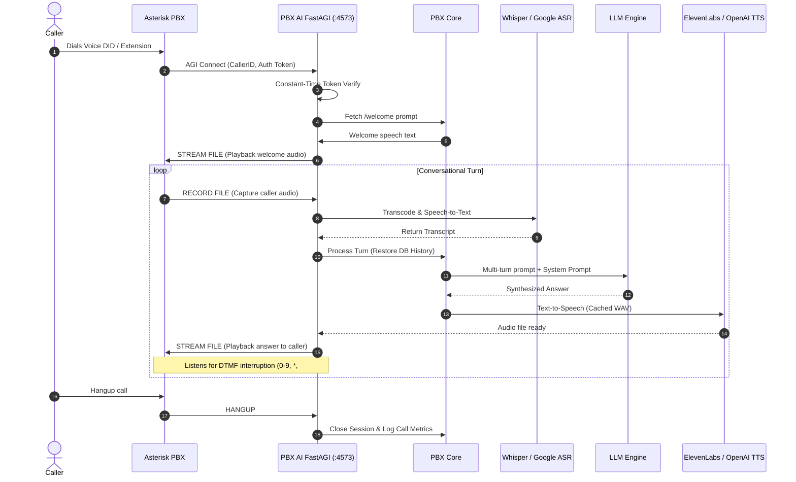
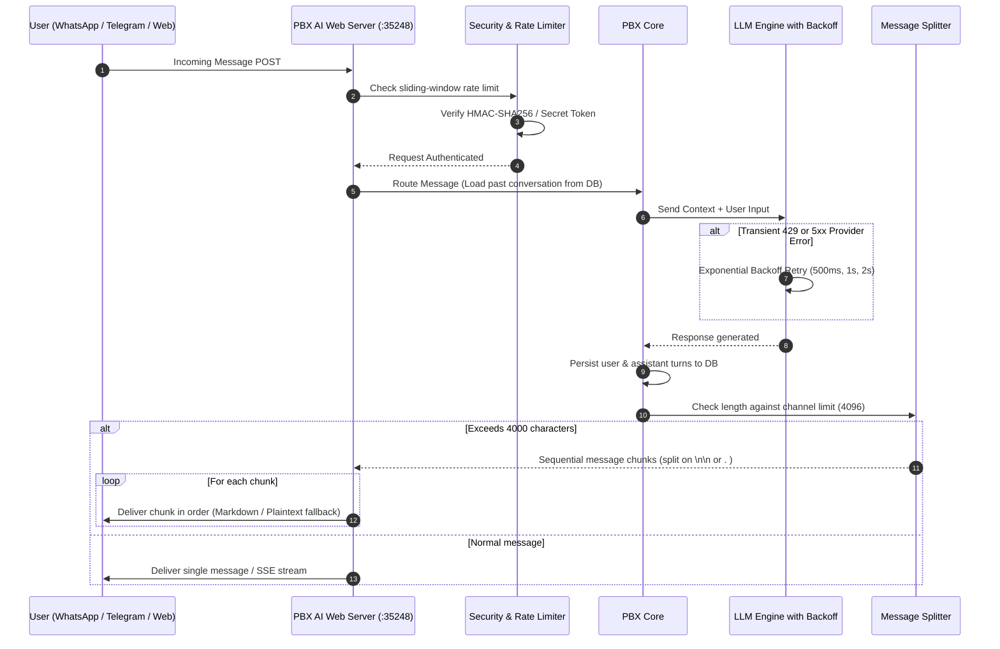

# PBX AI — System Architecture & Data Flow

This document details the architectural layers, message routing pipelines, telephony lifecycles, and observability systems implemented across PBX AI.

---

## 1. High-Level Architecture

---

## 2. Telephony Voice Call Flow (Asterisk FastAGI)

---

## 3. Webhook Messaging Pipeline (WhatsApp / Telegram / Web)

---

## 4. Observability & Metrics Architecture

- **Prometheus Scraper (`GET /metrics`):**
  Exposes gauges and counters for active sessions, total requests by channel, tokens consumed by model, and request duration.
- **Health Check (`GET /health`):**
  Provides structured JSON health statuses for container orchestration and uptime probes.
- **Operations Dashboard (`GET /dashboard`):**
  Real-time dark-mode control center rendering live sessions, audit logs (`aiLogs`), and provider statuses.
